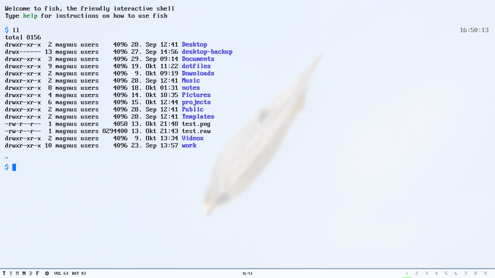

# Alacritty

Alacritty is the terminal emulator — GPU-accelerated and minimal, configured in TOML (`alacritty.toml`). Tabs and splits are left to tmux; the terminal stays a thin, fast layer.

## Does

- GPU-accelerated rendering with low input latency
- Minimal chrome (no window decorations, default 93% background opacity)
- `PxPlus IBM VGA 8x16` font at 20 points by default
- Imports colors, opacity, font size and padding from
  `~/.local/state/dotfiles-theme/alacritty.toml`, updated by the local Rust
  writer; theme changes and appearance sliders preserve each other's fields
- Vi mode for scrollback navigation and buffer search

## Keybinds

- `Ctrl+Shift+Space` - toggle Vi mode; inside it use `/` `?` `n` `N` natively
- `Shift+Enter` - send Escape followed by Return

## Workflow

Run tmux inside Alacritty for sessions, tabs, and splits. Its bindings are defined
directly in the [tmux config](../../tmux/showcase/README.md), using `Alt` for
panes and tabs and `Alt+A` as the prefix for sessions and other commands.
Alacritty has no tmux-specific key remaps or custom tmux escape sequences.
Use Vi mode to navigate scrollback without reaching for the mouse.

Settings > Appearance > Adjustments changes opacity, font size and padding
live. Build the local writer once with `make -C tools/appearancectl`.
