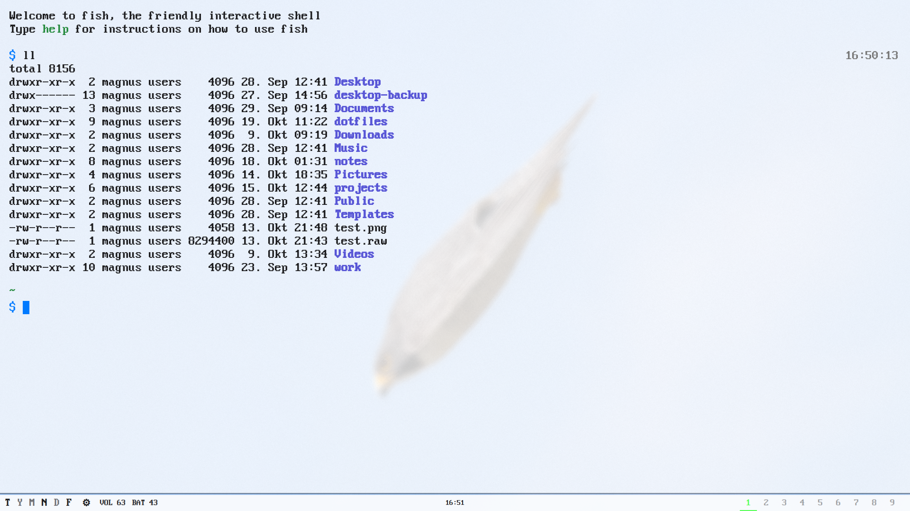

# Alacritty

Alacritty is the terminal emulator — GPU-accelerated and minimal, configured in TOML (`alacritty.toml`). Tabs and splits are left to tmux; the terminal stays a thin, fast layer.



## Does

- GPU-accelerated rendering with low input latency
- Minimal chrome (no window decorations, 85% background opacity)
- `PxPlus IBM VGA 8x16` font at 19 points and 23-pixel padding
- Imports only colors from `colors.toml`; font, opacity and padding live directly
  in `alacritty.toml`. Gruvbox Dark is the default.
- Vi mode for scrollback navigation and buffer search

## Keybinds

- `Ctrl+Shift+Space` - toggle Vi mode; inside it use `/` `?` `n` `N` natively
- `Alt+Shift+Enter` - send a distinct key sequence for tmux's create-pane binding

## Workflow

Run tmux inside Alacritty for sessions, tabs, and splits. Its bindings are defined
directly in the [tmux config](../../tmux/showcase/README.md), using `Alt` for
panes and tabs and `Alt+A` as the prefix for sessions and other commands.
The `Alt+Shift+Enter` escape sequence keeps it distinct from `Alt+Enter`, so
tmux can distinguish creating a pane from swapping it with the master.
Use Vi mode to navigate scrollback without reaching for the mouse.

## Light and dark

In Zsh, run `dark` for Gruvbox Dark or `light` for Gruvbox Light. The functions
in `.config/zsh/.zshrc` copy a normal theme file from `themes/` to `colors.toml`
and set GTK's native Adwaita light/dark preference. Alacritty reloads the colors.
No service, palette generator or local compiled tool is involved.

The selected colors persist in `colors.toml`; switching changes that tracked
file. New checkouts default to Gruvbox Dark. Native GTK preferences do not force
every third-party app to switch, and Neovim keeps its own color handling.

Manual equivalent for the terminal alone:

```sh
cp ~/.config/alacritty/themes/gruvbox-dark.toml ~/.config/alacritty/colors.toml
```

To adjust permanent settings, edit `font.size`, `window.opacity` or
`window.padding` in `alacritty.toml`. Native Alacritty font-size shortcuts change
only the current window; they do not modify your config or call a script.
