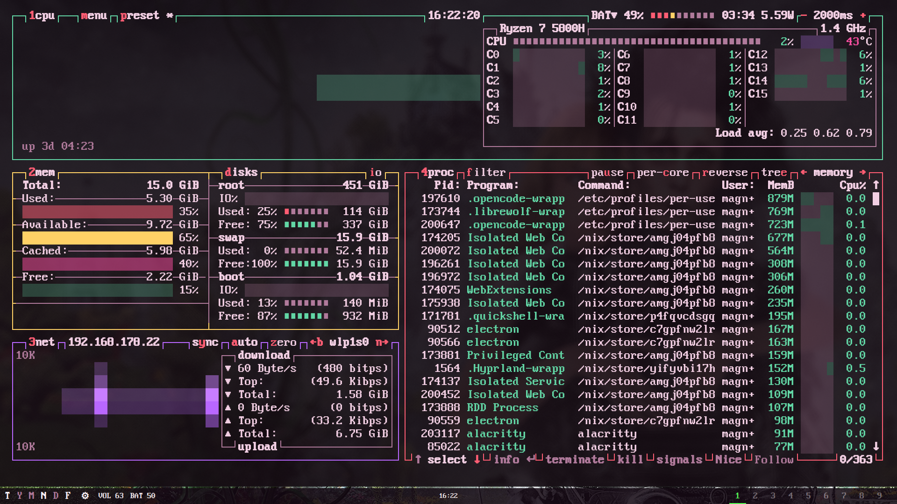

# btop

Retro system monitor using btop's built-in TTY mode. Configuration lives in
`../btop.conf` and is linked to `~/.config/btop/btop.conf` by Home Manager.

## Settings

- `force_tty = true` forces 16 colors, TTY graph symbols and square corners.
- `theme_background = false` leaves the terminal background visible.
- `proc_sorting = "memory"` keeps the existing process sorting preference.
- `save_config_on_exit = false` keeps temporary menu changes out of the dotfiles.

## Theme integration

TTY mode ignores custom btop themes and uses Alacritty's 16 ANSI colors instead.
The `dark` and `light` Zsh functions select static Gruvbox Dark/Light files;
there is no palette generator. In a real Linux virtual console, Alacritty's
theme does not configure the console colors.
