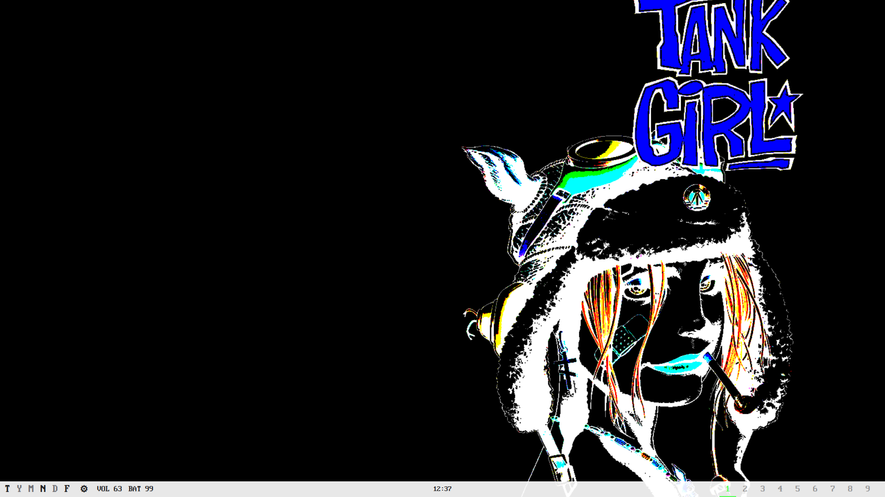

# Hyprland

`SUPER` is the main desktop modifier.

## Does

- Keyboard-first window control
- Numbered workspaces for daily contexts
- Scratchpads for temporary apps
- `awww` wallpaper setup
- Clipboard history stored by cliphist, accessible from the terminal
- Volume and media keys through wpctl and playerctl
- Polkit authentication prompts through the GNOME agent
- Rofi 2 for application launching and native Wayland window switching

## Desktop Role

Hyprland runs the desktop and `awww` sets the wallpaper. There is no desktop
shell, bar, notification daemon, lock screen or idle service. In particular,
the session does not lock automatically or before suspend.

## Config

- `hyprland.lua` - Main Hyprland config
- `lua/` - Split Lua modules for monitors, binds, workspaces, and appearance

## Apps

Home Manager links the Polkit authentication agent at `~/.local/bin/polkit-agent`;
Hyprland starts it on login so privileged desktop actions can show password prompts.

- `SUPER+Shift+Return` - Alacritty terminal

Type to filter, use up/down to select, Enter to activate, and Escape to cancel.
The two launchers are separate: applications launch an app; windows focus an
existing window. Neither launcher mixes both kinds of results.

The bindings run `rofi -show drun -modes drun` and
`rofi -show window -modes window` respectively.
Rofi uses its standard configuration and runs only when opened. No custom scripts,
extensions, background service or extra flake is needed.

## Leader

Press `SUPER+A`, release both keys, then press one of the keys below
without modifiers unless noted. Each action returns to normal bindings automatically.

| Key | Action |
| --- | --- |
| `Space` | Rofi: search and launch installed applications |
| `w` | Rofi: search and focus open windows |
| `Enter` | Terminal scratchpad |
| `b` | Browser scratchpad (LibreWolf) |
| `d` | Discord scratchpad |
| `c` | Chat scratchpad (SimpleX) |
| `n` | Notes scratchpad |
| `f` | File manager scratchpad |
| `m` | YouTube Music scratchpad |
| `r` | Reader scratchpad (Foliate) |
| `Escape` | Cancel |

Unknown keys also cancel the leader mode. For example, `SUPER+A`, then
`b` toggles the browser scratchpad.

The command entry keys are `SUPER+A` for Hyprland, `Alt+A` for tmux, and
`Space` for Neovim. The normal terminal launch remains `SUPER+Shift+Return`;
the browser is accessed through Rofi, its scratchpad or the terminal.

## Session

- `SUPER+F1` - Suspend
- `SUPER+S` - Select an area and copy the screenshot directly to the clipboard

Cancel the area selection with Escape. No screenshot file is created, and no
automatic screenshot cleanup is configured. Screen recordings are started
manually with `wf-recorder` and stopped with Ctrl+C.

## Clipboard

Every clipboard change is stored by cliphist. Use `cliphist list` in the terminal
to inspect the history; there is no graphical clipboard picker.

## Audio

- `SUPER+=/-` - Volume up/down
- `SUPER+0` - Toggle mute
- `XF86Audio*` keys - Volume, mute, microphone mute, play/pause, next, previous

For manual control, use `wpctl status`, `wpctl set-volume @DEFAULT_AUDIO_SINK@ 5%+`
or `wpctl set-mute @DEFAULT_AUDIO_SINK@ toggle`.

## Appearance

Run `dark` or `light` in Zsh for Gruvbox terminal colors and native GTK light/dark
preferences. For wallpaper changes, use `awww img "/path/to/image.png"`.
To change the login wallpaper permanently, edit `lua/autostart.lua`.

## Windows

- `SUPER+Q` - Close window
- `SUPER+Z` - Fullscreen
- `SUPER+Shift+Space` - Toggle floating
- `SUPER+J/K` - Focus next/previous window in the master stack, wrapping at the ends
- `SUPER+Shift+J/K` - Swap with the next/previous window in the master stack, wrapping at the ends
- `SUPER+H/L` - Shrink/grow the master area by five percentage points
- `SUPER+Return` - Swap the focused window with the master

## Workspaces

- `SUPER+N/P` - Next/previous workspace number, including empty workspaces
- `SUPER+Tab` - Last-used workspace
- `SUPER+1..9` - Go to workspace
- `SUPER+Shift+1..9` - Move window to workspace
- `SUPER+Alt+[/]` - Move window to previous/next workspace

Workspace selection mirrors tmux tab selection: `SUPER` here, `Alt` in tmux,
with the same `1..9`, `Tab`, and `N/P` keys. Letter bindings do not require
Shift unless it is explicitly shown.

## Workflow

Start from the terminal, keep long-running work on workspaces, pull
scratchpads in only when needed, and walk the master stack with `SUPER+J/K`.
Use `SUPER+H/L` to adjust the space given to the master window.
