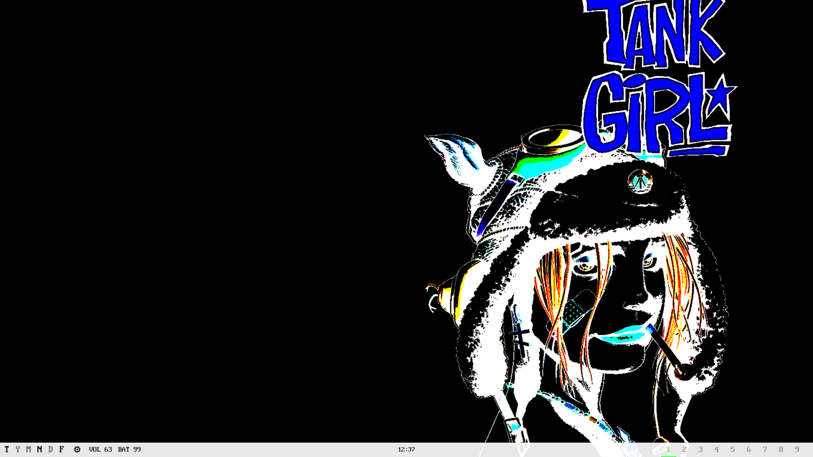

# Hyprland

`SUPER` is the main desktop modifier.

## Does

- Keyboard-first window control
- Numbered workspaces for daily contexts
- Scratchpads for temporary apps
- `awww` wallpaper setup
- Quickshell session locking, automatically through Hypridle after thirty idle minutes
- Clipboard history with image previews through cliphist and Quickshell
- Volume and media keys through wpctl and playerctl
- Polkit authentication prompts through the GNOME agent
- Quickshell desktop widgets and settings menu

## Desktop Role

Hyprland runs the desktop, `awww` sets the wallpaper, Quickshell provides the
desktop widgets and the lock screen, and Hypridle locks it after thirty
idle minutes, turns the monitor off five minutes later, and locks before suspend.

## Config

- `hyprland.lua` - Main Hyprland config
- `lua/` - Split Lua modules for monitors, binds, workspaces, and appearance
- `hypridle.conf` - Idle timeouts and suspend hooks
- `scripts/` - Recording and polkit helpers

## Apps

- `SUPER+Shift+Return` - Alacritty terminal

## Leader

Press `SUPER+A`, release both keys, then press one of the keys below
without modifiers unless noted. Each action returns to normal bindings automatically.

| Key | Action |
| --- | --- |
| `Space` | Quickshell app launcher |
| `w` | Quickshell window switcher with a live preview |
| `g` | Quickshell settings menu |
| `v` | Quickshell clipboard history |
| `p` | Toggle Quickshell bottom bar |
| `t` | Toggle both Quickshell Tux widgets |
| `s` | Area screenshot to clipboard |
| `Shift+v` | Toggle recording |
| `Enter` | Terminal scratchpad |
| `b` | Browser scratchpad (LibreWolf) |
| `d` | Discord scratchpad |
| `c` | Chat scratchpad (SimpleX) |
| `n` | Notes scratchpad |
| `f` | File manager scratchpad |
| `m` | YouTube Music scratchpad |
| `r` | Reader scratchpad (Foliate) |
| `Escape` | Cancel |

Unknown keys also cancel the leader mode. For example, `SUPER+A`, then
`p` toggles the bottom bar. Scratchpad actions show or hide the corresponding app.

The command entry keys are `SUPER+A` for Hyprland, `Alt+A` for tmux, and
`Space` for Neovim. The normal terminal launch remains `SUPER+Shift+Return`;
the browser is accessed through its scratchpad or the app launcher.

The app launcher and window switcher are Quickshell windows that open without
compositor animations.

## Session

- `SUPER+Escape` - Lock
- `SUPER+F1` - Suspend
- `SUPER+S` - Area screenshot to file

## Clipboard

Every clipboard change is stored by cliphist. The history shows the full text
or image of the highlighted entry; inside it, `Delete` removes an entry and
`Shift+Delete` wipes the history.

## Audio

- `SUPER+=/-` - Volume up/down
- `SUPER+0` - Toggle mute
- `XF86Audio*` keys - Volume, mute, microphone mute, play/pause, next, previous

Audio bindings also work on the lock screen. The Quickshell bar shows the level.

## Windows

- `SUPER+Q` - Close window
- `SUPER+F` - Fullscreen
- `SUPER+Shift+Space` - Toggle floating
- `SUPER+J/K` - Focus next/previous window in the master stack, wrapping at the ends
- `SUPER+Shift+J/K` - Swap with the next/previous window in the master stack, wrapping at the ends
- `SUPER+H/L` - Shrink/grow the master area by five percentage points
- `SUPER+Return` - Swap the focused window with the master

## Workspaces

- `SUPER+N/P` - Next/previous workspace number, including empty workspaces
- `SUPER+Tab` - Last-used workspace
- `SUPER+1..9` - Go to workspace
- `SUPER+Shift+1..9` - Move window to workspace
- `SUPER+Alt+[/]` - Move window to previous/next workspace

Workspace selection mirrors tmux tab selection: `SUPER` here, `Alt` in tmux,
with the same `1..9`, `Tab`, and `N/P` keys. Letter bindings do not require
Shift unless it is explicitly shown.

## Workflow

Start from the launcher or terminal, keep long-running work on workspaces, pull
scratchpads in only when needed, and walk the master stack with `SUPER+J/K`.
Use `SUPER+H/L` to adjust the space given to the master window.
