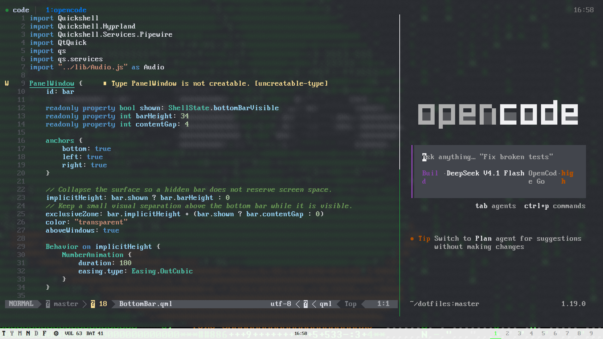

# Neovim Setup



Configuration lives in `~/dotfiles/.config/nvim/init.lua`. Home Manager links
it to `~/.config/nvim` with `mkOutOfStoreSymlink` (`nix/home/magnus.nix`), so
the link chain ends in the repo:

```
~/.config/nvim -> /nix/store/...-home-manager-files/.config/nvim -> ~/dotfiles/.config/nvim
```

Edits in the repo apply on the next Neovim start without a rebuild. Only
changing the link itself needs `sudo nixos-rebuild switch --flake ~/dotfiles/nix`.

## Files

- `init.lua` - editor options (line numbers, clipboard, cursor), loads the modules below
- `lua/core/ui.lua` - VSCode-like syntax colors and transparent backgrounds
- `lua/core/plugins.lua` - plugins and their setup
- `lua/core/keymaps.lua` - all custom keybinds
- `lua/core/format.lua` - Conform setup and filetype-to-formatter map
- `lua/core/lsp.lua` - enables the language servers
- `lsp/<name>.lua` - one config per language server
- `nvim-pack-lock.json` - pinned plugin revisions

## Plugins

Plugins are installed by Neovim's built-in `vim.pack`; the first start after
adding one asks for confirmation.

- `blink.cmp` - completion from LSP, paths, snippets and buffer words, with
  automatic documentation. Pinned to stable v1; uses the Lua fuzzy matcher
  without a native binary. Snippets use Neovim's built-in snippet engine;
  no additional snippet collection is installed. Blink's command-line completion
  is disabled; Noice displays Neovim's command-line completion menu.
- `opencode.nvim` - on-demand editor context and actions for OpenCode in tmux,
  pinned to v1.0.2 for OpenCode v1. Uses Snacks input and picker interfaces.

- `nvim-treesitter` - syntax highlighting and indentation. Parsers are
  compiled locally with `tree-sitter` and `gcc` from `home.packages`.
- `nvim-ts-autotag` - automatically closes HTML/JSX/TSX tags and renames matching
  tag pairs. Tag and prop suggestions still come from the language server.
- `tsc.nvim` - asynchronous TypeScript project checks, with results in Quickfix
  and Neovim diagnostics.
- `snacks.nvim` - file explorer and pickers (files, grep, LSP symbols, git status,
  diagnostics), plus indentation guides with the current scope highlighted.
  Opening a directory (`nvim .`) opens the explorer instead of netrw.
- `gitsigns.nvim` - marks changed lines in the sign column, side-by-side diff
- `which-key.nvim` - popup after `Space` listing the possible next keys
- `conform.nvim` - formats the current buffer with the formatter for its filetype
- `lualine.nvim` - statusline with mode, git branch, diff, diagnostics, file and
  cursor position; font rendering is handled by Alacritty
- `noice.nvim` - popup command/search input, message history and LSP UI;
  complements Lualine rather than replacing the statusline
- `nui.nvim` - required UI library for Noice's popups, menus and layouts;
  no separate user-facing commands or configuration needed
- `flash.nvim` - labeled jumps, Treesitter selections and remote operator actions;
  native `/`, `?`, `f`, `F`, `t`, `T`, `;` and `,` stay unchanged
- `render-markdown.nvim` - renders Markdown in the buffer; `:RenderMarkdown toggle`
  switches back to plain text

## Command line and messages (Noice)

`:` commands and `/` / `?` searches open in a popup. Command-line completion
appears alongside it (`command_palette` preset); long messages open in a split
(`long_message_to_split` preset). Lualine keeps its existing statusline setup.
No additional notification plugin is installed: Noice can use the existing
Snacks notification backend, with its built-in mini view as a fallback.

- `:Noice` or `:Noice history` - message history
- `:Noice last` - last message in a popup
- `:Noice errors` - error history
- `:Noice dismiss` - dismiss visible messages
- `:Noice disable` / `:Noice enable` - temporarily switch Noice off/on
- `:checkhealth noice` - check dependencies and parser availability

Setup lives in `lua/core/plugins.lua`; `nui.nvim` and `noice.nvim` are installed
through `vim.pack` and pinned in `nvim-pack-lock.json`. The additional `vim`,
`regex` and `bash` Treesitter parsers highlight command and search input.
Restart Neovim after configuration changes; no NixOS rebuild is needed.

Neovim's native partial-command display is enabled with `showcmd = true` and
`showcmdloc = "statusline"`. Lualine's right-hand section includes `%S` before
encoding, file format and filetype; its other default sections stay unchanged.
The Noice search popup also shows `d/`, `y/`, `c?`, etc. in place of its search
icon when an operator is pending. Plain searches show `/` (forward) or `?`
(backward) instead of magnifying-glass and arrow icons.
Noice has no built-in option for this; the small `SearchOperator` autocmd in
`lua/core/plugins.lua` changes only the displayed icon, not the search text or
keybindings. Counts and register prefixes remain in Lualine's native display;
the popup prefix shows only the operator and search direction.

## Language servers

Enabled in `lua/core/lsp.lua`, one config per server in `lsp/<name>.lua`:

- Go `gopls`, Rust `rust_analyzer`, TypeScript/JavaScript `vtsls`
- JavaScript/TypeScript (including JSX/TSX) `eslint` for project lint rules
- Python `pyright` (types) and `ruff` (lint, format)
- Nix `nixd`, Lua `lua_ls`, XML `lemminx` (Odoo views and data)
- JSON `jsonls`, CSS `cssls`, HTML `html`, Svelte `svelte`
- Bash `bashls`, Typst `tinymist`, YAML `yamlls`
- Docker `dockerls` (Compose files go through `yamlls`), QML `qmlls` (Quickshell)
- Ansible `ansiblels`, only for files under `playbooks/` or `roles/*/tasks|handlers/`

The server binaries come from Nix (`nix/home/packages.nix`). Rust's standard
library sources are provided through `RUST_SRC_PATH` in the same module.
Errors show at the end of the line, including in Insert mode, and inlay hints
are on. Rust's full Cargo diagnostics run on save; rust-analyzer also reports
its own live diagnostics on unsaved changes.
Blink's completion menu opens automatically while typing; `Ctrl+Space` requests
suggestions manually (and toggles documentation when the menu is already open).
Nothing is preselected or inserted automatically. `Ctrl+N` / `Ctrl+P` select,
`Ctrl+Y` accepts the selected item or the first item if none is selected, and
`Ctrl+E` closes. `Tab` / `Shift+Tab` jump between snippet placeholders, otherwise
keep their usual behavior. `Enter` remains a newline. `Ctrl+B` / `Ctrl+F` scroll
the completion documentation in Insert mode. Native `Ctrl+X Ctrl+O` remains a
separate Omni-completion path; use `Ctrl+Space` for Blink. `K` shows documentation
in Normal mode; `Ctrl+S` shows signature help in Insert mode.
`:checkhealth vim.lsp` shows which
server attached. Reference configs for other servers: the `lsp/` folder of
[nvim-lspconfig](https://github.com/neovim/nvim-lspconfig/tree/master/lsp).

## Keybinds

Leader is `Space`; after pressing it, `which-key` shows the possible next keys.
Entering Visual mode with `v`, `V` or `Ctrl+V` does not open help automatically.
Press `Space+?` in Normal or Visual mode to open the current mode's key overview
on demand; leader help remains available in Visual mode.

- `Space+e` - toggle the fullscreen file explorer; type to filter, Enter opens
- `Space+a+a` - ask OpenCode about the cursor position or visual selection
- `Space+a+s` - select an OpenCode prompt, command or server action
- `Space+c+f` - format the current buffer (Conform, with LSP fallback)
- `Space+c+r` - rename the symbol under the cursor
- `Space+c+l` - restart the language servers attached to the current buffer
- `Space+c+t` - type-check the TypeScript project (`:TSC`)
- `Space+c+a` - code actions for the cursor or visual selection
- `Space+f+f` - find files across the git repo (dotfiles included)
- `Space+f+s` - find LSP symbols in the current file (functions, structs, methods, etc.)
- `Space+f+S` - search LSP symbols across the workspace, updated live while typing (`S` = Shift+s)
- `Space+/` - grep across the git repo
- `Space+g+s` - changed files of the git repo, including untracked ones
  - `Enter` on a submodule - open its git status
  - `Ctrl+G` inside the picker - back up to the parent repo
- `Space+g+d` - toggle side-by-side diff of the current file against git
- `Space+x+x` - all LSP errors and warnings (like "Problems" in VS Code/Zed)
- `]c` / `[c` - next/previous git change

Symbol search requires an attached LSP that supports document or workspace
symbols. `Space+/` remains text search; it also finds comments and strings.

LSP navigation uses Snacks pickers: `gd` definitions, `gr` / `grr` references,
`grt` type definitions and `gri` implementations. A single result jumps directly;
multiple results open a picker with preview. `Ctrl+O` returns after a jump and
`Ctrl+I` moves forward in the jump history. These mappings replace Vim's local
declaration search (`gd`) and virtual replace character (`gr`). Neovim's other
LSP defaults remain available (`:h lsp-defaults`): `K` hover, `grn` rename and
`gra` code action.
The `gr` mapping also prefixes the built-in `gr…` mappings, so it waits briefly
for another key; `grr` requests references without that prefix wait.
which-key reads mapping descriptions automatically; only group names are
configured separately in `lua/core/plugins.lua`.

## Flash navigation

- `s` - type part of the target text, then press its displayed label to jump
- `S` - select a labeled Treesitter node (requires a parser for the buffer)
- `r` after an operator - remote action: `yr`, find/select a target, then `iw`
  copies that word and returns to the original position
- `R` in Operator-pending or Visual mode - search and select a Treesitter range
- `Esc` - cancel Flash

`s` and `S` work in Normal, Visual and Operator-pending modes, so `ds` deletes
to a Flash target. These follow Flash's recommended mappings; they replace the
native `s`/`S` substitute commands (use `cl`/`cc` in Normal mode instead).
Normal-mode `r` (replace character) and `R` (Replace mode) remain unchanged.
Mappings live in `lua/core/keymaps.lua`; setup lives in `lua/core/plugins.lua`.

## Formatting and checks

`Space+c+f` formats the current buffer. The central `formatters_by_ft` table is
in `lua/core/format.lua`:

- Python: Ruff; Rust: rustfmt; Go: gofmt
- Lua: StyLua; Nix: nixfmt
- JS/TS (including JSX/TSX), JSON/JSONC, HTML, CSS/SCSS/Less, Markdown and YAML
  (including Ansible and Compose): Prettier
- Shell: shfmt; Fish: fish_indent; QML: qmlformat
- Other filetypes, such as XML, Svelte and Typst: attached LSP, if it supports formatting

Formatter executables are provided by `nix/home/packages.nix` and Fish.
After adding packages, run `sudo nixos-rebuild switch --flake ~/dotfiles/nix`.
Conform uses the formatter's project configuration; its Prettier integration
prefers a project-local executable when available. Run `:ConformInfo` to inspect
the selected formatter, executable availability and errors.

Editor indentation defaults to four spaces (`expandtab`, `tabstop = 4`,
`shiftwidth = 4`, `softtabstop = -1`). Filetype settings can override these;
Neovim's built-in EditorConfig support applies project `.editorconfig` settings.
Prettier also defaults to four spaces, with project Prettier/EditorConfig settings
taking precedence. Other formatters keep their own configuration and language
conventions (for example, gofmt uses tabs). A Prettier config controls formatting,
not the editor's Tab key; use `.editorconfig` to keep both consistent.

Linting and type checking are separate from formatting. The existing language
servers publish diagnostics automatically: for example, Ruff lints Python while
Pyright checks types. `Space+x+x` lists diagnostics; `gra` opens LSP code actions
for fixes. Full-project checks and tests still belong in the project's terminal
commands or CI (for example `ruff check .`, `pyright`, `cargo clippy`,
`cargo test`, or `tsc --noEmit`, depending on the project).

`Space+c+l` (built-in `:lsp restart`) restarts attached servers when they get
stuck; it is not a full-project check. Use `:checkhealth vim.lsp` to inspect
attachment and `:lsp enable vtsls` / `:lsp enable eslint` if a server is disabled.

### TypeScript project checks

Save files, then press `Space+c+t` (`:TSC`) from the TypeScript project root.
`tsc.nvim` prefers the project's `node_modules/.bin/tsc`, falling back to PATH.
It runs `--build --noEmit` to include referenced TypeScript projects without
emitting JavaScript. TypeScript may still write incremental build metadata.
Results populate Quickfix and diagnostics (`Space+x+x`), including errors in
unopened files. Results reflect the last check; rerun after fixing errors.
The plugin currently replaces diagnostics per file while processing errors,
so only the last error per file may appear in diagnostics; Quickfix contains
the complete results.
The Quickfix window opens on errors; `:copen`, `:cnext` and `:cprev` navigate it.
`:TSCStop` stops a running check. Checks are manual, not automatically run on save.

### ESLint for JavaScript and React

`vtsls` checks types; `eslint` reports the project's lint rules while typing.
The project needs its own ESLint dependency and configuration. React Hooks
rules require the corresponding plugin and rules in that project configuration.
Both flat config (`eslint.config.*`) and legacy `.eslintrc*` files are recognized;
`package.json` and `.git` are fallback workspace markers.

Use `Space+c+a` (or `gra`) for fixes and `Space+x+x` to inspect diagnostics. Fixes do not run
automatically on save, and Prettier remains the formatter for `Space+c+f`.
The server comes from the existing `vscode-langservers-extracted` Nix package,
so this editor configuration change needs no rebuild. Restart Neovim to load it.

## OpenCode

Start Neovim and `opencode --port 0` in the same project directory, in separate
tmux panes. The port flag exposes OpenCode's local server on a dynamically
assigned port so the plugin can discover it. Restart an existing OpenCode TUI
with that flag if it was started without a server port.
Discovery requires `pgrep` and `lsof`; `lsof` is provided alongside the Neovim
dependencies in `nix/home/magnus.nix`. Rebuild after adding that package.

Save files before asking: OpenCode reads referenced files from disk.
`Space+a+a` opens a Snacks input with `@this` (the selection or cursor location).
`Space+a+s` opens the Snacks action picker, including explain, review and
diagnostics prompts. Context placeholders also include `@buffer`, `@buffers`,
`@diagnostics` and `@quickfix`. Both mappings work in Normal and Visual mode.

The plugin connects on demand and can reload buffers after OpenCode edits.
If no server is found, it asks you to start OpenCode in tmux instead of creating
an embedded terminal. `:checkhealth opencode` checks dependencies and discovery.

## Editor options

- A block cursor in every mode, including Insert (`guicursor = "a:block"`).
- Mouse handling disabled so the terminal handles selection (`mouse = ""`).
- True color rendering enabled (`termguicolors = true`).
- Yank, delete and put through the system clipboard (`clipboard = "unnamedplus"`).
- Absolute line numbers in the gutter (`number = true`).

## Built-in commands

- `:edit path/to/file` opens a file; Tab completes paths.
- `/pattern` searches; `n` and `N` move between matches.
- `Ctrl+F` / `Ctrl+U` move forward a page / back half a page.
- `:ls` lists buffers; `:buffer N` switches to one.
- `:split` and `:vsplit` split the window; `Ctrl+W` moves between windows.
- `Ctrl+N` and `Ctrl+P` complete words in Insert mode on demand.
- `"+y` and `"+p` use the system clipboard when a clipboard provider is available.
- `:help` opens the built-in documentation; `:help lua-guide` covers Lua configuration.
