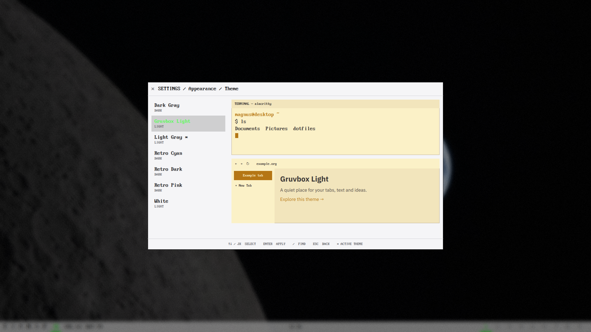

# Quickshell

Small desktop shell for Hyprland, built with [Quickshell](https://quickshell.outfoxxed.me/).
Configuration and daily controls otherwise live in the terminal.

## What stays

- **Bottom bar** — workspaces, special workspaces, clock, volume, battery and recording.
- **Tux widgets** — both animated mascots.
- **Theme switcher** — palette selection with terminal/browser previews.
- **Notifications** — popups, click to dismiss; critical notifications do not expire.
- **Lock screen** — separate process, PAM authentication, started by Hypridle.

There is no settings menu, app launcher, window switcher, clipboard picker or
wallpaper picker. Volume, terminal adjustments, wallpaper and session actions
are managed with terminal commands or existing Hyprland bindings.

## Theme switcher

Press `Super+A`, release it, then `g`, or run:

```sh
qs -p "$HOME/.config/quickshell" ipc call theme toggle
```

- Starts in normal mode: `j/k` or up/down select a palette.
- `i` or `/` edits the filter. `Esc` returns to normal mode and keeps the filter.
- While editing, arrows move the text cursor, not the result selection.
- `Enter` applies the palette; `l` or right also applies in normal mode.
- `h`, left or `Esc` closes in normal mode; the × always closes.



## Structure

- `shell.qml` — bottom bar, theme switcher, notifications, Tux and Pipewire tracking.
- `modules/BottomBar.qml` / `TuxMascot.qml` / `NotificationPopups.qml` — desktop widgets.
- `modules/ThemeSwitcher.qml` — the theme window, header and keyboard hints.
- `modules/theme/` — palette loading, selection and previews.
- `modules/search/` — text input, filtering and normal/insert focus switching.
- `modules/keyboard/` — local action definitions and their visible hints.
- `services/ShellState.qml` — visibility and IPC for the bar, Tux and theme switcher.
- `services/Workspaces.qml` / `Time.qml` / `Battery.qml` / `Recording.qml` — bar data.
- `services/Notifications.qml` — notification daemon.
- `Colors.qml` / `Fonts.qml` / `ThemePaths.qml` — shared appearance and theme paths.
- `lib/Audio.js` — read-only volume helpers for the bar.
- `lock.qml` — independent lock screen, so a shell reload cannot unlock the session.
- `assets/` — Tux sprites. Other showcase images document earlier configurations.

## Terminal controls

```sh
wpctl set-volume @DEFAULT_AUDIO_SINK@ 5%+
wpctl set-volume @DEFAULT_AUDIO_SINK@ 5%-
wpctl set-mute @DEFAULT_AUDIO_SINK@ toggle
awww img /path/to/wallpaper.png
```

The local appearance writer remains available at `~/.local/bin/appearancectl`.
Theme changes still update Alacritty and GTK; terminal overrides remain supported.
Build writer changes with `sudo nixos-rebuild switch --flake ~/dotfiles/nix`.

## Run

```sh
qs -p "$HOME/.config/quickshell"
```

Started automatically by Hyprland. Requirements: Quickshell, Hyprland, Pipewire,
UPower, `awww`, `dconf`, `wf-recorder` and the local appearance writer.

The lock screen runs separately:

```sh
qs -n -d -p "$HOME/.config/quickshell/lock.qml"
```
