# Quickshell

My desktop shell for Hyprland, built with [Quickshell](https://quickshell.outfoxxed.me/)
(QtQuick/QML). Replaces the previous EWW setup.

## Screenshots

Light Gray, Dark Gray, Retro Dark and Retro Cyan, with a different wallpaper for each view.

### Settings

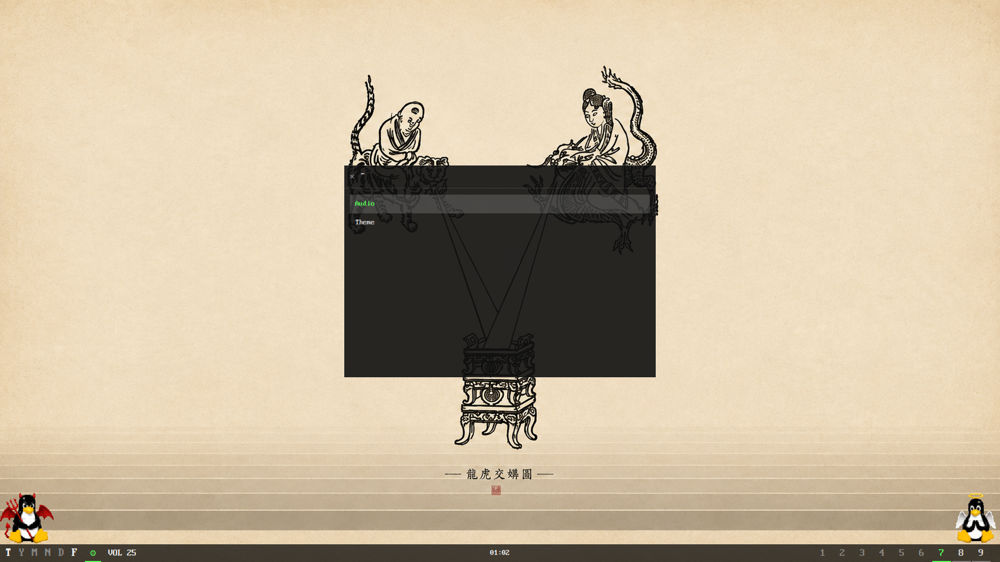

### Applications

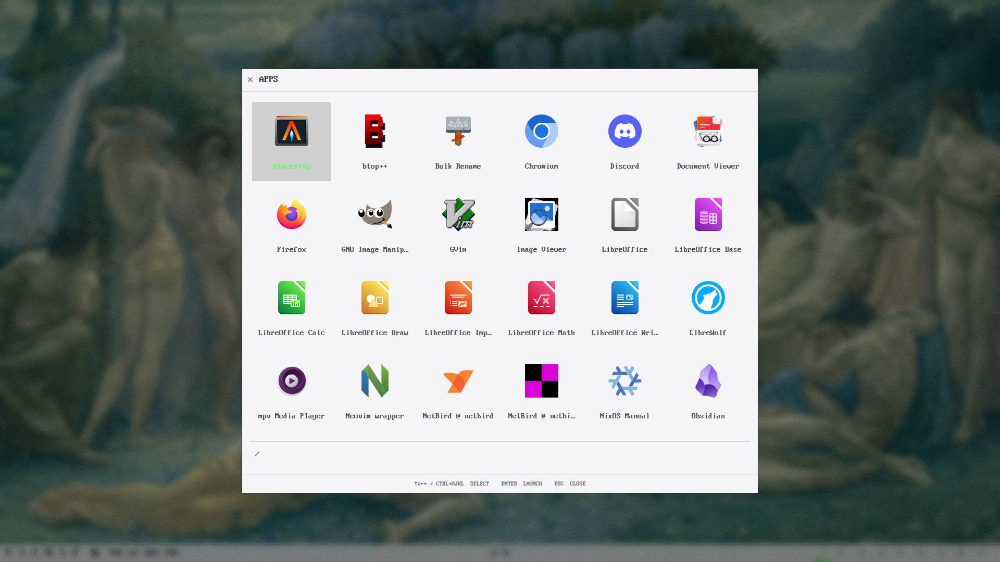

### Window switcher — Retro Cyan

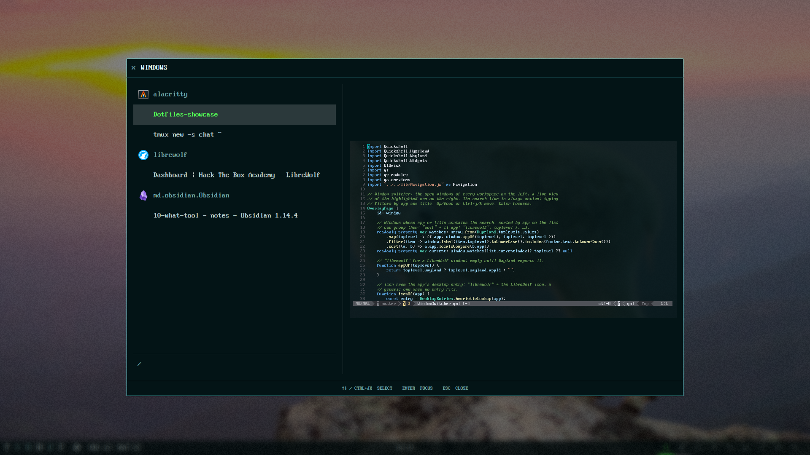

### Clipboard

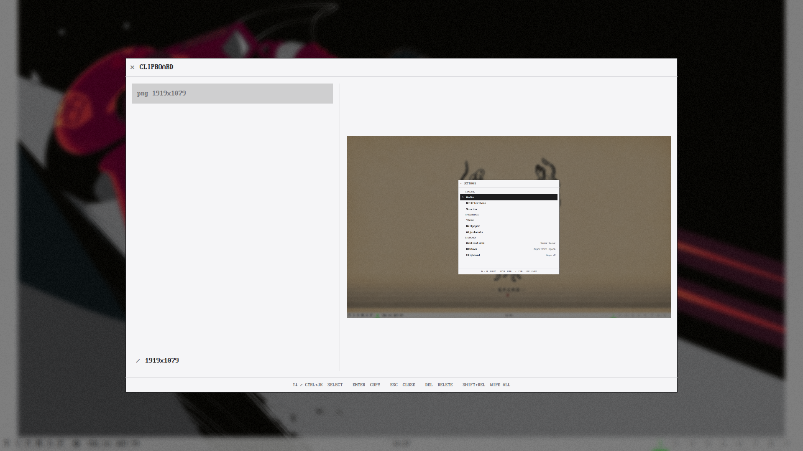

### Theme selection

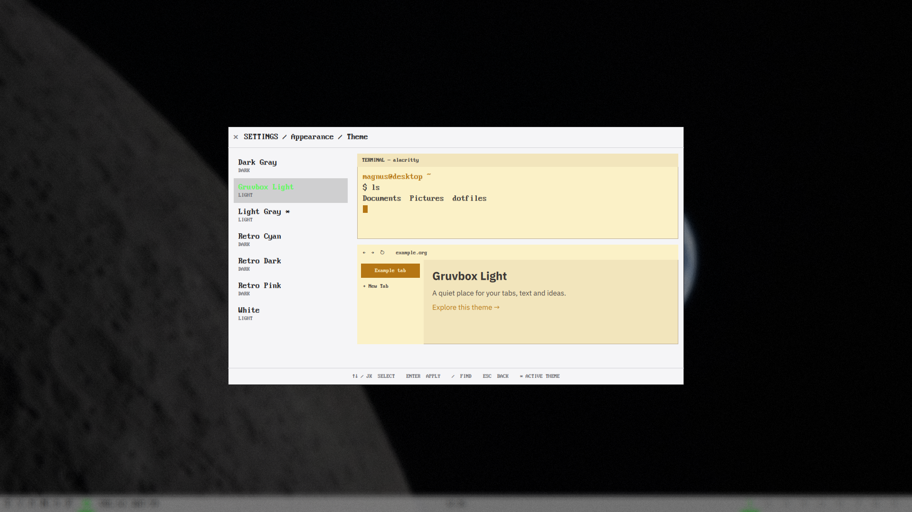

### Wallpaper selection

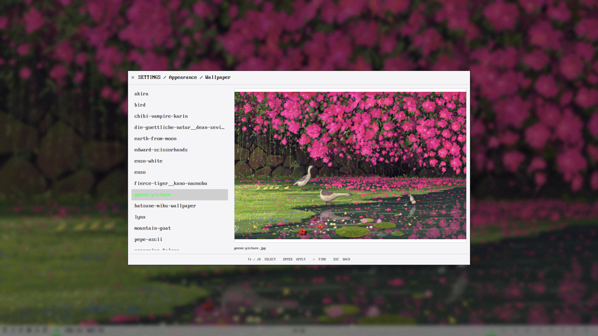

### Audio — Dark Gray

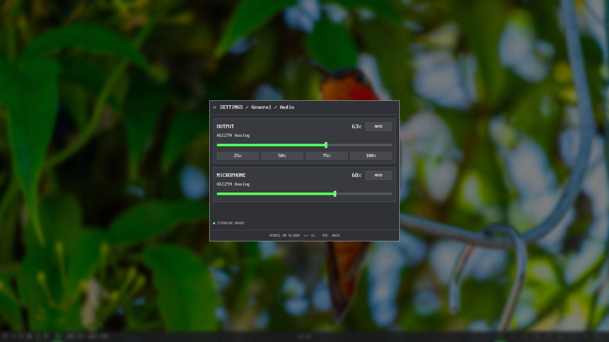

### Terminal adjustments — Dark Gray

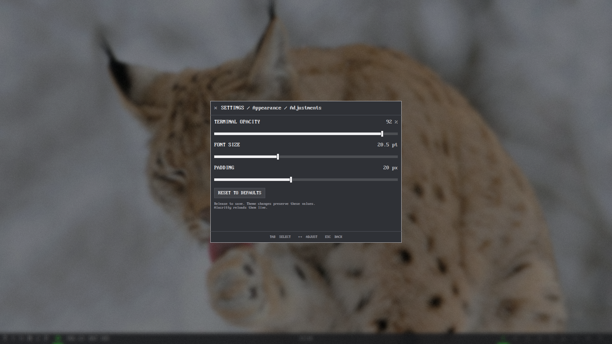

### Notifications — Retro Dark

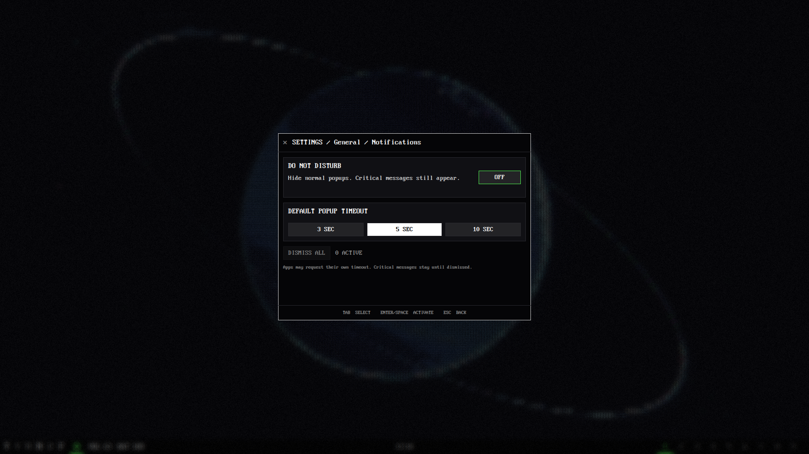

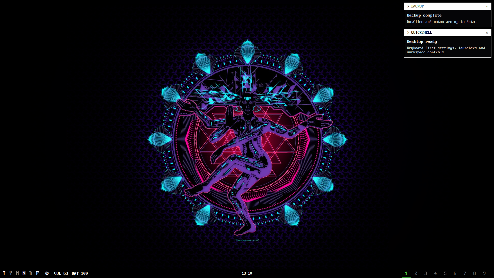

### Session — Retro Dark

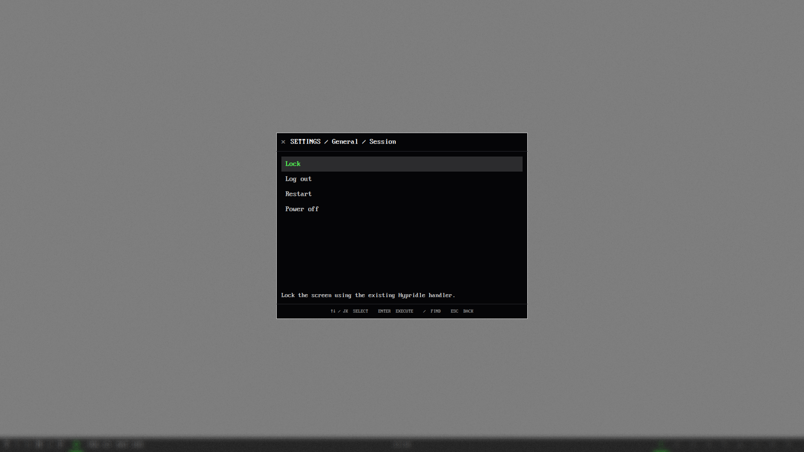

## Structure

- `lock.qml` — lock screen, run as its own process (`qs -n -d -p
  ~/.config/quickshell/lock.qml`) so a shell bug or hot reload can not unlock
  the session: blurred wallpaper, clock, password checked through PAM
  (`quickshell-lock` service from the NixOS config).
- `shell.qml` — composition root: wires `modules/` components together, keeps no
  state of its own beyond the Pipewire object tracker.
- `Fonts.qml` — shared font family and pixel sizes for all shell text, including
  the bar, launchers, settings, notifications and lock screen.
- `ThemePaths.qml` — shared QML paths to `~/.local/bin/appearancectl` and
  `~/.local/state/dotfiles-theme`, the writer's fixed state directory.
- `LauncherStyle.qml` — shared spacing, icons and panel dimensions for the app
  launcher, window switcher and clipboard history. Colors come from `Colors.qml`.
- `services/` — singletons holding all shared state and logic:
  - `ShellState.qml` — panel visibility (bottom bar, workspace HUD, tux), the
    current overlay page and its Settings origin, plus IPC toggles. Back returns
    to Settings when opened there, otherwise closes; dismiss always closes.
  - `Workspaces.qml` — Hyprland workspace/special-workspace queries and the
    active-special-workspace tracking (seeded from `Hyprland.monitors`, kept
    live via `rawEvent`).
  - `Time.qml` — clock.
  - `Battery.qml` — laptop battery percentage and charging state through UPower;
    hidden on machines without a laptop battery.
  - `Recording.qml` — `wf-recorder` status/toggle.
  - `Notifications.qml` — notification daemon: owns
    `org.freedesktop.Notifications` on D-Bus and keeps the open notifications.
- `modules/` — UI panels, purely presentational, bound to the services above:
  - `OverlayWindow.qml` — shared full-screen backdrop for settings and launchers:
    50% black with Hyprland background blur, keeping the panel sharp and centered.
  - `ShellOverlay.qml` — the single overlay window: loads the current page and
    owns its title, content padding, dimensions and bottom keyboard legend.
  - `OverlayPage.qml` — focus scope for page content, with presentation properties
    for the shared frame and a required `keyBindings` reference. Each page explicitly
    defines its actions, key handler and initial focus, including back navigation;
    pages do not create windows or footers.
  - `BottomBar.qml` — workspace strip, clock, recording indicator, volume text,
    laptop battery percentage, settings menu trigger, special workspace buttons.
  - `WorkspaceHud.qml` — compact workspace-only overlay.
  - `Breadcrumbs.qml` — display-only header with a single title string, e.g.
    `× SETTINGS / Appearance / Theme`; the × reports a close request.
  - `search/SearchField.qml` — `/ cy` search line; it only types and hands every
    key to its `keyTargets` first, so the owner decides what keys drive.
    The settings, wallpaper and theme views open it on `/`.
  - `search/SearchFilter.qml` — local `entries` + `query` + `textFor(entry)` →
    `matches`. It owns no selection, focus or UI.
  - `keyboard/KeyBindings.qml` — local `actions` with `keys`, optional exact
    `modifiers`, `label`, optional `enabled`, and `run()` callbacks. `handle(event)`
    executes an enabled matching action; `hints` describes the same enabled actions.
  - `keyboard/KeyboardHints.qml` — display-only keyboard legend in the shared frame.
    Each page supplies its own `keyBindings`, including control activation actions.
    The legend is generated from the same enabled actions
    used for keyboard handling. Extra text describes native controls or state.
    All searchable pages compose a filter, native ListView/GridView, search field
    and key bindings directly. Pages own their connections, current entry and
    previews; there is no combined searchable-view wrapper or global key registry.
  - `preview/ImagePreview.qml` — shared aspect-preserving image display with
    asynchronous loading, empty text and loading/error states.
  - `settings/wallpaper/WallpaperPreview.qml` — image preview, frame and filename.
  - `settings/theme/ThemePreview.qml` — terminal/browser previews and empty state.
  - `launcher/clipboard/ClipboardPreview.qml` — plain text or the shared image preview.
  - `launcher/windows/WindowPreview.qml` — live capture of the selected window;
    receives the toplevel and active state from the switcher page.
  - `launcher/AppLauncher.qml` — GNOME-style grid of the desktop apps with an
    always active search; arrows or Ctrl+hjkl move, Enter starts. Esc returns to
    Settings when opened there, otherwise closes. The × always closes everything.
  - `launcher/WindowSwitcher.qml` — open windows of every workspace on the
    left, grouped by app under an icon header, a live view of the highlighted
    one on the right; same search.
  - `launcher/ClipboardHistory.qml` — cliphist entries, newest first, with
    the full text or image of the highlighted one on the right; same search,
    Enter copies the entry back.
  - `settings/` — the settings menu (Super+G), with all categories visible together:
    - `SettingsMenu.qml` — General (Audio, Notifications, Session), Appearance (Theme, Wallpaper, Adjustments), and
      Launcher (Applications, Windows, Clipboard). One definition supplies names,
      routes and shortcut hints. Search removes empty categories; every entry
      opens a page in the shared overlay with Settings as its one-level parent.
      The TUI-style start list uses an inverted selection bar with a `>` marker.
    - `AudioPage.qml` — compact output and microphone cards inside a bounded
      scroll area, with Pipewire status pinned below.
    - `NotificationsPage.qml` — do-not-disturb, default timeout (3/5/10 seconds),
      active count and dismiss-all controls. Critical notifications bypass DND.
      These preferences apply to the current shell session.
    - `SessionPage.qml` — searchable lock, logout, restart and shutdown actions.
      Locking uses `loginctl lock-session` and the existing Hypridle handler.
    - `SettingsButton.qml` — square buttons with Tab focus and a clicked signal;
      the owning page defines keyboard activation.
    - `AdjustmentsPage.qml` / `SettingSlider.qml` — terminal opacity, font size
      and padding. The page owns selection and keyboard actions: j/k or arrows
      select controls, h/l or left/right adjust values, and Enter/Space activates
      reset. Keyboard changes save immediately; dragging saves on release through
      the local Rust writer. Reset restores defaults without changing the theme.
    - `ThemePage.qml` — searchable palette names with terminal and browser
      color previews; highlighting previews a palette, Enter applies it.
    - `theme/TerminalPreview.qml` / `theme/BrowserPreview.qml` — illustrative
      previews that read the highlighted palette independently of the active theme.
    - `WallpaperPage.qml` — searchable files from `~/.config/wallpapers` on
      the left, an aspect-preserving preview on the right; Enter sets the
      highlighted image through `awww`.
  - `AudioControl.qml` — output/input card with mute, volume percentage,
    a draggable slider, wheel adjustment in 2% steps and optional presets.
  - `NotificationPopups.qml` — retro notification popups top right: square
    borders, an inverted app-name header and VGA text. Titles use up to two
    lines, bodies up to four with ellipsis. Normal ones expire after 5s,
    critical ones have a red `!` header and stay; a click closes one.
  - `TuxMascot.qml` — left/right mascot panel.
- `lib/Audio.js` — Pipewire audio helper functions.
- `services/Appearance.qml` — watches the shared terminal TOML, reads the current
  values through `appearancectl get` and queues writes to its local binary.
- `assets/` — animated angel/devil Tux sprites.

## What it does

- **Workspaces** — live Hyprland workspaces plus named *special* workspaces
  (term, files, music, notes, discord, firefox), highlighted with the shared accent.
- **Clock** — `hh:mm`, centered in the bottom bar.
- **Settings menu** — centered keyboard-driven menu on Super+G.
- **Themes** — White, Light Gray, Dark Gray, Gruvbox Light, Retro Dark,
  Retro Cyan and Retro Pink palettes from `~/.config/themes/palettes`.
  Light Gray restores the original pale gray appearance with a dark terminal;
  White uses a white background and terminal. Retro Dark is the black variant.
  Gruvbox Light uses a warm beige background and a light terminal.
  Shell backgrounds and text follow the palette, with a shared green accent and
  red danger color. Alacritty and GTK colors are generated by `appearancectl`.
- **Audio** — volume via Pipewire (`Quickshell.Services.Pipewire`).
- **Battery** — percentage in the bar when a laptop battery is present; low charge
  is red unless charging.
- **Recording indicator** — shows when a screen recording is active.
- **Notifications** — replaces Dunst, colored by the current theme. General >
  Notifications controls do-not-disturb and the default popup duration; app-specified
  timeouts still take precedence (in milliseconds; zero disables expiry), and
  critical messages remain until dismissed.
- **Session** — General > Session offers locking, logout, restart and shutdown.
- **Tux mascot** — animated, can be toggled.

## Requirements

Build the local appearance writer once with
`make -C tools/appearancectl` (Rust 1.89+, Cargo and Make). Home Manager links
the built binary to `~/.local/bin/appearancectl`, which Hyprland and Quickshell
call. It is used for theme changes, login restoration and the terminal
adjustment sliders.

- `quickshell`
- Hyprland (uses `Quickshell.Hyprland`)
- Pipewire (uses `Quickshell.Services.Pipewire`)
- UPower for the laptop battery indicator (`Quickshell.Services.UPower`)
- `awww` for wallpapers; `dconf` for GTK theme preferences
- `cliphist` and `wl-clipboard` for clipboard history; `wf-recorder` for recording

## Run

```bash
qs -p "$HOME/.config/quickshell"
```

Started automatically from Hyprland's native Lua autostart module.
