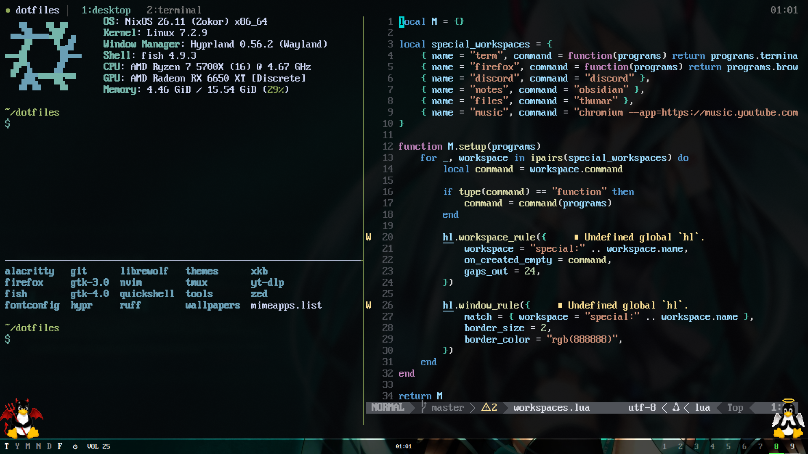

# Tmux

Tmux keeps terminal sessions alive. Use named sessions for separate projects or
services, and reattach to resume long-running work.

## Keybinds

- `Alt+A` - prefix; press and release it before the next key
- `Alt+A`, then `Alt+A` - send Alt+A to the application
- `Ctrl+A` reaches the application directly (for example, shell line start or incrementing a number in Neovim)

Hyprland uses `Super+A` as its leader, tmux uses `Alt+A`, and Neovim uses
`Space`, keeping each layer's command entry separate.

### Sessions and tabs

- Prefix, then `Shift+n` - create a named session
- Prefix, then `s` - session chooser
- Prefix, then `r` - rename the current session
- Prefix, then `x` - close the current session after confirmation
- Prefix, then `d` - detach; sessions keep running
- Prefix, then `c` - create a window (tab)
- Prefix, then `n` - create a window (tab) in the current directory
- Prefix, then `q` - close the current window and all its panes after confirmation
- Prefix, then `,` - rename the current tab
- `Alt+1..9` - select a tab directly (also available with prefix, then `1..9`)
- `Alt+Tab` - last-used tab (also available with prefix, then `Tab`)
- `Alt+N/P` - next/previous tab

Except where Shift is shown explicitly, letter bindings do not require Shift.
Tab navigation cycles through existing tabs.
Closing a session switches to another existing session instead of detaching,
as long as another session remains.

### Panes

- `Alt+Shift+Enter` - create a pane in the current directory and apply the master layout
- `Alt+Enter` - swap the current pane with the left master pane and focus the master
- `Alt+J/K` - focus next/previous pane, wrapping at the ends
- `Alt+Shift+J/K` - swap the current pane with the next/previous pane
- `Alt+H/L` - shrink/grow the left master pane by five columns
- `Alt+Q` - close the current pane
- `Alt+F` - toggle pane zoom

The master layout (`main-vertical`) gives the left master pane 55% of the width,
matching Hyprland, and places the remaining panes in a stack on the right.
Creating a pane reapplies this layout.

### Copy mode

Pane history keeps up to 100,000 lines; the history limit applies to newly created panes.

- `Alt+V` (without Shift) or prefix, then `[` - enter copy mode
- `Alt+/` / `Alt+?` - enter copy mode and search down/up directly
- `j/k`, `Ctrl+U/D`, `g/G` - move, half page, top/bottom
- `/` `?` then `n/N` - search down/up, next/previous match
- `v` / `V` / `Ctrl+V` - select characters / lines / a block
- `y` - copy the selection to the clipboard and leave
- `q` - leave without copying

## Terminal integration

`Alt` controls tmux panes and tabs, mirroring `Super` for Hyprland windows and
workspaces. Bindings live directly in tmux; Alacritty sends a distinct sequence
for `Alt+Shift+Enter` so it does not collide with `Alt+Enter`.
It also sends a distinct `Ctrl+Shift+Enter` for Neovim splits; tmux forwards
extended keys to applications requesting them.
